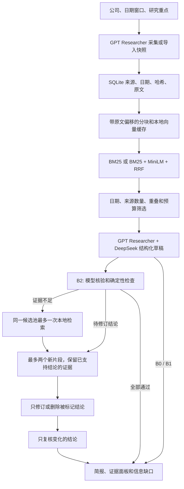

# 架构与 proposal 对照

GPT Researcher 保留搜索规划、采集和 `write_report`；FinNews 增加可重放证据、
片段级混合检索、严格 JSON 模型和有限反馈控制。没有额外引入多智能体框架、
向量数据库服务、模型微调或交易系统。

## 检索与日期

真实模式使用 MiniLM tokenizer，片段不超过 180 encoder tokens，约 24 token 重叠；
标题和片段共同受 256 token 限制。向量归一化后使用 NumPy 余弦相似度。
BM25 和 dense 各取最多 20 个候选，以 `sum(1/(60+rank))` 融合。
缓存键包含模型配置和文本指纹。

最多选择 8 个片段、每来源 3 个、背景 2 个；上下文预算包括 ID、标题、URL、日期。
DeepSeek 服务端 token 数与公共计数器可能不同，实际收费以返回 usage 为准。
无 tokenizer 缓存时使用保守字节上界，避免演示隐式下载。

日期窗口为 `[as_of-(window_days-1), as_of]`。未来来源不参与检索，更早来源标为背景；
未知日期的资料存储展示但不建立窗口内事件。发布时间、事件时间和报告期不能互换。

## 有界状态机

正常路径最多 draft、verify、revise、recheck 四个逻辑阶段，整个运行共享一次
schema repair。修订只能作用于首次核验标记的 finding ID，不能改变受保护结论。
补充检索不访问网络和参考答案，只在原候选池内进行。

已支持结论的证据固定保留；最多引入两个新片段，保持数量和预算约束。未修复结论
删除并转为信息缺口。超时后已有草稿标为 `unverified`；解析或约束失败记录为失败。
具体上游重试行为和请求记录边界见项目报告。

引句和数字检查只是必要条件，不证明因果或经济解释正确。模型核验属于运行状态，
正式质量分数只能由独立人工标注得出。

## 评测隔离

`Query` 只有公司、日期、重点和 source IDs，不包含 gold facts。参考事实及 span 留在
评测模块。固定快照实验使用相同候选池和公共预算；B0/B1 比较检索，B1/B2 比较整个
核验恢复策略。演示 hash encoder / deterministic provider 不代替真实消融实验。
